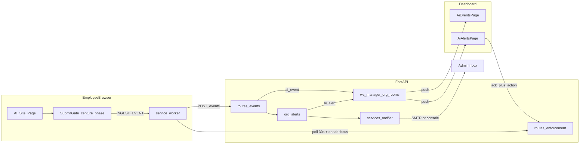

# CyberSentinel — Master Plan (v1 Showcase + Sellable Release)

Status: APPROVED SCOPE · Owner: Manas · Executor: agent (Auto) + human QA
Companion: [`MASTER_CHECKLIST.md`](MASTER_CHECKLIST.md) (execute from there, tick boxes there)

---

## 0. Ground rules (read before any phase)

1. **Never break what runs today.** Current working baseline (verified Oct 27 2026):
   - API `uvicorn app.main:app --port 8000` → `/api/health` = `{"status":"ok","pipeline_mode":"gemini_only"}`
   - Frontend `npm run dev` → `http://localhost:5173`
   - Extension `extension/` loads unpacked; signup/login/invite/accept-invite work.
2. **Additive only.** New behavior ships behind a setting whose default == today's behavior.
   - Submit mode default `observe`. Email backend default `console`. Auto-seed only when `STORAGE_BACKEND=memory` and `ENVIRONMENT=development`.
3. **One phase = one branch = one commit set.** Branch `feat/pN-<slug>`. Merge to `main` only after phase gate is green.
4. **No hallucinated features.** Every claim in README / landing / sales copy must map to a file + test listed in Section 11 (Truth Table).
5. **Real paths only.** Code lives at repo root: `backend/`, `frontend/`, `extension/`. The `aisentinel/` prefix in old docs is stale.
6. **Token-lean execution.** Agent reads only files named in the active subphase. Use caveman-style terse output for code runs (see `Plan/CAVEMAN_SETUP.md`); full sentences only for user-facing copy and policy text.

---

## 1. Verified current state (audit, not assumption)

| Area | Reality in code | Evidence |
| :--- | :--- | :--- |
| Auth (JWT, signup, invite, accept) | Working | `backend/app/api/v1/routes_auth.py`, `routes_users.py` |
| Org + user tokens for extension | Working | `serializers_org.py` (`org_api_key`, `user_token`) |
| Event ingest + DLP + dedupe | Working | `routes_events.py`, `services/dlp.py`, `services/hybrid_dlp.py` |
| Alerts on medium+ risk | Working | `services/org_alerts.py::create_alert_for_event` |
| Enforcement (close tabs / blackout) | Working, **60 s poll lag** | `extension/background.js` alarm `enforcementPoll` `periodInMinutes: 1` |
| Dashboard events refresh | **8 s polling**, no push | `frontend/src/pages/AiEventsPage.tsx:56` |
| WebSocket | Exists, **threats only** | `routes_ws.py` `/ws/threats`; only `db/crud_threats.py` broadcasts |
| Demo seed | Script exists, **not run in memory mode** → `admin@demo.com` fails after restart | `app/scripts/seed_org.py`, `db/connection.py` |
| Billing / Stripe | **Built** (checkout, portal, webhook, dev-activate, plans, seats) — screenshot table is outdated | `routes_billing.py`, `services/plans.py`, `frontend/src/pages/BillingPage.tsx` |
| JIT gate | Built, but runs **after** send already fired (mousedown capture) → cannot stop ChatGPT | `extension/ai-content.js` lines ~110-138 |
| Hard block of AI submits | **Not built** | no capture-phase preventDefault in `ai-content.js` |
| Email alerts / digests | **Not built** (settings fields exist: `alert_email`, `notify_on_critical`, `daily_digest`) | `routes_auth.py` signup settings; no SMTP in `core/config.py` |
| Shadow AI helper | Exists, not in manifest (DEFERRED) | `extension/engine/shadow-ai.js` |
| Tokenizer | Thin stub (DEFERRED vault) | `extension/engine/tokenizer.js` |
| CI | **None** (`.github/` absent) | repo root |
| Docs | Paths say `aisentinel/...`; seed tokens referenced but not auto-created | `v1_plan_docs/*.md` |

---

## 2. Scope

### In scope (this plan)
- P0 Safety baseline
- P1 Truth + docs alignment
- P2 Demo-ready boot (deterministic seed + demo data)
- P3 Real-time sync (kill extension → dashboard lag)
- P4 Hard block / warn of AI submits (policy-driven)
- P5 Email alerts + daily digest
- P6 Billing verification + hardening (already built)
- P7 Showcase polish (UI, landing honesty, demo flow)
- P8 Tests + CI
- P9 Release packaging + sales kit

### Confirmed deferred (do NOT build; keep out of marketing claims)
| Item | Allowed wording in copy |
| :--- | :--- |
| Bi-directional tokenization vault | "Roadmap" only |
| WASM / WebGPU local ML audit | "Roadmap" only |
| Shadow-AI unknown-site protect | "Roadmap" only; ChatGPT/Claude/Gemini/Google are the monitored surfaces |
| Enterprise SSO / SAML / Okta | "Available on request / roadmap" |
| Federated intel marketplace | Do not mention |
| Deepfake **video** product claims | Remove; image-signal analysis only |
| Next.js migration | Internal doc only (`07b`) |
| Full SIEM / enterprise browser | "CSV export + webhook roadmap" only |

---

## 3. Target architecture after plan

---

## 4. Phase P0 — Safety baseline (no code changes)

Goal: freeze a known-good state so any regression is detectable and reversible.

### P0.1 Stop running processes
- Stop uvicorn (port 8000) and Vite (port 5173) started earlier.
- Verify ports free: `Get-NetTCPConnection -LocalPort 8000,5173` returns nothing.

### P0.2 Git safety
- Commit or stash untracked `Plan/`, `v1_plan_docs/`, `image.png` on `main` as `docs: add planning docs` (docs only).
- Tag `baseline-2026-10-27`.

### P0.3 Baseline test run
- `cd backend; .\.venv\Scripts\python.exe -m pytest -q tests` → record pass/fail counts into `Plan/BASELINE.md`.
- `cd frontend; npm run build` and `npm run lint` → record result.
- Known failures recorded are NOT fixed in P0; they become P8 items.

### P0.4 Manual smoke (record in `Plan/BASELINE.md`)
- Health, signup, login, Events page loads, extension Config saves, one ChatGPT prompt → one event.

Gate P0: baseline file exists; tag pushed locally.

---

## 5. Phase P1 — Truth + docs alignment

Goal: docs describe the real repo. No product code changes.

### P1.1 Path fix
- `v1_plan_docs/*.md`: replace `aisentinel/extension/` → `extension/`, `aisentinel/backend/main.py` → `backend/app/main.py`, `aisentinel/frontend/` → `frontend/`, `backend/api/events.py` → `backend/app/api/v1/routes_events.py`, `models/documents.py` → `backend/app/db/documents_org.py`, `services/dlp.py` → `backend/app/services/dlp.py`.
- `v1_plan_docs/BACKEND.md`: `MONGODB_URL` → `MONGODB_URI`.

### P1.2 Status table truth
- Create `Plan/FEATURE_STATUS.md` with the Section 1 table + deferred list (single source for "what is built").
- Update screenshot-era table: Billing = "Built (Stripe + dev mode)".

### P1.3 Credentials doc
- `v1_plan_docs/TEAM_ONBOARDING.md`: keep `aisnl_org_demo123` / `aisnl_usr_admin123` (they become true after P2.1).

Gate P1: `rg "aisentinel/" v1_plan_docs` returns 0 hits.

---

## 6. Phase P2 — Demo-ready boot

Goal: fresh start → login with `admin@demo.com / password` and see a populated dashboard in < 60 s, every time.

### P2.1 Auto-seed in memory dev mode
- File: `backend/app/main.py` (lifespan, after `await init_db()`).
- New setting `SEED_DEMO: bool = True` in `backend/app/core/config.py`.
- Condition: `STORAGE_BACKEND == "memory"` AND `ENVIRONMENT == "development"` AND `SEED_DEMO`.
- Call existing `app.scripts.seed_org.seed()` (already idempotent: checks slug `democorp`).
- Wrap in try/except + log; seed failure must NOT block startup.
- Result tokens (deterministic): org `aisnl_org_demo123`, admin `aisnl_usr_admin123`, manager `aisnl_usr_mgr789`, employee `aisnl_usr_emp456`.

### P2.2 Demo AI events + alerts
- New `backend/app/scripts/seed_ai_demo.py::seed_ai_events(org)` — inserts ~25 `Event` docs over last 7 days across chatgpt/claude/gemini, mixed risk (none/low/medium/high/critical), using `services/dlp.py` scan on fixed sample prompts so risk fields are real, not hand-typed. Then calls `create_alert_for_event` for each.
- Uses `client_submit_id=f"demo-{i}"` → idempotent.
- Invoked from P2.1 only when org has zero events.
- Must be read against real `Event` model fields in `db/documents_org.py` before writing.

### P2.3 run-local hardening
- `run-local.ps1`: use `.\.venv\Scripts\python.exe -m uvicorn` (works without activation / no global python — matches this machine); check `frontend\node_modules` exists else `npm install`; print demo creds + tokens at end.

### P2.4 Extension defaults for dev
- `extension/popup.js`: placeholder already shows `http://localhost:8000`; add a "Use local demo" button that fills API URL, `aisnl_org_demo123`, `aisnl_usr_emp456`, `http://localhost:5173` — visible only when API URL is empty or localhost. No behavior change otherwise.

Gate P2: restart API → login demo admin works; Events page shows seeded rows; Alerts page shows HIGH/CRITICAL; extension "Use local demo" → "Monitoring active".

---

## 7. Phase P3 — Real-time sync (fix lag)

Goal: prompt sent in ChatGPT appears in dashboard ≤ 2 s; manager action reaches extension ≤ 30 s (≤ 2 s if AI tab focused).

### P3.1 Backend push
- `backend/app/api/v1/routes_events.py`: after successful ingest (not on dedupe hit) → `await ws_manager.broadcast({"type":"ai_event","data":event_list_item(...)}, org_id=str(org.id))`. Same after `PATCH .../response` with `type:"ai_event_update"`.
- `backend/app/services/org_alerts.py`: after `alert.insert()` → broadcast `{"type":"ai_alert","data":alert_public(alert,user)}`.
- Import `ws_manager` lazily inside function to avoid circular import; wrap in try/except (push failure never fails ingest).
- Note: `event_list_item` already redacts prompt (`reveal_prompt=False`) → safe to push.

### P3.2 Frontend subscribe
- `frontend/src/hooks/useWebSocket.ts`: read current message dispatch; add handlers for `ai_event`, `ai_event_update`, `ai_alert` that publish to a tiny event bus (zustand store `useLiveStore` or `window` CustomEvent — pick whichever matches existing store pattern in `frontend/src/stores/`).
- Ensure WS auth uses JWT `token` query (supported by `_ws_org_id`) — dashboard no longer relies on `VITE_API_KEY`.
- `AiEventsPage.tsx`: prepend/merge on `ai_event`; keep 8 s poll as fallback but raise to 30 s when WS connected.
- `AiAlertsPage.tsx`: prepend on `ai_alert`; toast for HIGH/CRITICAL.
- Sidebar: small "Live" dot (green when WS open).

### P3.3 Extension enforcement latency
- `extension/background.js`: `enforcementPoll` → `periodInMinutes: 0.5` (Chrome MV3 minimum 30 s).
- Add `chrome.tabs.onActivated` + `chrome.windows.onFocusChanged` → if active tab is AI host → poll enforcement (debounced 5 s).
- Existing content-script `POLL_ENFORCEMENT` on load stays.

### P3.4 Ingest latency
- Verify `INGEST_EVENT` sends immediately (not batched to `ingestRetry` alarm). Retry queue only on failure.

Gate P3: stopwatch test — send prompt → row visible ≤ 2 s without refresh; ack "Close all AI tabs" → tab closes ≤ 30 s.

---

## 8. Phase P4 — Hard block / warn of AI submits

Goal: org admin can choose `observe` (today) | `warn` | `block`. In warn/block the prompt is stopped **before** the AI site sends it.

### P4.1 Policy contract
- Org settings key `submit_mode`: `"observe" | "warn" | "block"`, default `"observe"`; `block_threshold`: `"high" | "critical"`, default `"critical"`.
- `backend/app/api/v1/routes_policies.py` cache response: include both (read file first; add keys without removing existing).
- `routes_org.py` settings PUT: validate enum values.
- Settings UI (`frontend/src/pages/...Settings` page used at `/ai/settings`): radio group + threshold select + explanatory text.

### P4.2 Capture-phase gate (extension)
- `extension/ai-content.js`: register `window.addEventListener('keydown', h, true)` and `('click', h, true)` (capture phase, runs before page handlers).
- Handler: if Enter (no Shift, composer focused) or click on platform send selector (`utils/helpers.js::resolvePlatformConfig`) → read composer text → run sync `window.__CyberSentinel.runClientAudit` (from `engine/audit-rules.js`, already loaded on AI hosts).
- If `submit_mode==='observe'` → do nothing (today's path).
- If risk ≥ threshold:
  - `block`: `preventDefault()` + `stopImmediatePropagation()`; show blocking overlay (reuse `ui/jit-overlay.js` styling) with findings; ingest event with `enforcement_outcome:"blocked"`; no send.
  - `warn`: same stop; overlay with "Cancel" / "Send anyway + reason"; on send-anyway set `bypassOnce=true` and re-trigger native click on send button; ingest with `enforcement_outcome:"warned_sent"` + justification; on cancel `"warned_cancelled"`.
- `bypassOnce` guard prevents infinite loop; reset after one dispatch.
- Existing dedupe (`client_submit_id`, `submitInFlight`) must still produce exactly one event per user intent.

### P4.3 Backend fields
- `schemas/ai_guard.py::EventIngestRequest`: add `enforcement_outcome: Optional[str] = None`.
- `db/documents_org.py::Event`: add same optional field (default None → old docs fine).
- `serializers_org.py::event_list_item`: expose it.
- Alert creation: blocked events still alert (severity unchanged) with title prefix "Blocked:".

### P4.4 Dashboard surfacing
- Events table: badge `Blocked` / `Warned→Sent` / `Warned→Cancelled`.
- Overview KPI: "Prompts blocked (7d)".

### P4.5 Per-platform verification
- ChatGPT, Claude, Gemini each: Enter + click send in all three modes. Record in checklist matrix.

Gate P4: observe mode identical to baseline (one event, send proceeds); block mode with `AKIA...` style test key never reaches AI site on all 3 platforms.

---

## 9. Phase P5 — Email alerts + daily digest

Goal: admins get an email on HIGH/CRITICAL and an optional daily summary. Zero external dependency in dev.

### P5.1 Config
- `core/config.py`: `EMAIL_BACKEND="console"` (`console|smtp`), `SMTP_HOST`, `SMTP_PORT=587`, `SMTP_USER`, `SMTP_PASSWORD`, `SMTP_FROM`, `SMTP_TLS=True`, `DIGEST_ENABLED=False`, `DIGEST_HOUR_UTC=3`.
- Mirror in `backend/.env.example` with comments.

### P5.2 Notifier service
- New `backend/app/services/notifier.py`: `async send_email(to, subject, text, html=None)`; console backend logs via loguru; smtp backend uses stdlib `smtplib` inside `asyncio.to_thread`. Never raises to caller (log + return False).
- Templates: plain text + minimal inline-HTML (no template engine dependency).

### P5.3 Instant alert email
- `services/org_alerts.py`: after insert, if `severity in ("HIGH","CRITICAL")` and org `settings.notify_on_critical` and `settings.alert_email` → fire-and-forget `asyncio.create_task(send_email(...))`. Body: user, platform, reasons, dashboard deep link `${FRONTEND_URL}/ai/alerts`. Never include full prompt text.
- Rate limit: max 1 email per org per 60 s per alert_type (in-memory dict; Redis optional later).

### P5.4 Daily digest
- `services/notifier.py::build_digest(org)`: counts last 24 h events by risk, top 5 users by risk, open alerts.
- Admin endpoint `POST /api/admin/digest/send-now` (require_admin) → sends to `alert_email`; returns preview JSON (used by Admin Verify + demo).
- If `DIGEST_ENABLED`: background loop in lifespan checks hourly, sends at `DIGEST_HOUR_UTC` for orgs with `daily_digest: true`; stores `last_digest_at` in org settings to avoid duplicates.

### P5.5 UI
- Org Settings: alert email field, two toggles (exists? read `OrgSettingsPage.tsx` first; add only missing), "Send test email" button → `/api/admin/digest/send-now`.
- Admin Verify page: "Email backend: console|smtp" row.

Gate P5: console backend logs alert email on CRITICAL ingest; send-now returns preview; with real SMTP (Gmail app password / Mailtrap) email arrives.

---

## 10. Phase P6 — Billing verification + hardening

Goal: prove the already-built billing works end-to-end; no new billing features.

### P6.1 Verify
- `stripe` present in `backend/requirements.txt` (add if missing).
- Dev path: `ALLOW_DEV_BILLING=true` → Billing page → activate starter → plan reflects; seat limit enforced on invite (`assert_seat_available`).
- Stripe test mode (optional, needs keys): checkout → webhook (`stripe listen --forward-to localhost:8000/api/billing/webhook`) → plan `starter`.

### P6.2 Harden
- Webhook: idempotency — ignore already-applied `event.id` (store last N ids on org or a small collection).
- Billing page: clear "Dev mode" banner when `billing_mode=="dev"`.
- Trial expiry: verify `plans.py` quota blocks ingest gracefully (HTTP 402/403 with message) and extension shows message, not silent failure.

Gate P6: `tests/test_phase6_billing_quota.py` green + manual dev-activate flow recorded.

---

## 11. Phase P7 — Showcase polish

Goal: a buyer demo that is honest, fast, and visually clean.

### P7.1 Claims audit
- `rg -i "video|deepfake|okta|saml|sso|wasm|webgpu|siem|marketplace|federated" frontend/src extension README.md` → each hit either true (keep) or rewritten to roadmap/removed.
- README "What it detects" + Section 11 truth table aligned.

### P7.2 Demo flow (scripted, 7 minutes)
1. Landing → Sign in (demo prefilled).
2. AI Overview KPIs (seeded data).
3. Open ChatGPT in second window with extension (employee token) → paste fake AWS key → **blocked** overlay (P4).
4. Dashboard: event appears live (P3) + CRITICAL alert toast.
5. Alert → Acknowledge → Blackout → employee AI tab blacked out ≤ 30 s.
6. Email (console log or Mailtrap inbox) shows alert (P5).
7. Settings → switch to `warn` → justify-and-send flow.
8. Billing → plan + seats.
9. Threat Analyzer `/dashboard` → phishing URL explain (Gemini key required; else mock clearly labeled).
- Write as `Plan/DEMO_SCRIPT.md`.

### P7.3 UI polish (no redesign)
- Empty states on Events/Alerts/Users.
- Loading skeletons where spinners missing.
- Consistent toasts for every mutation.
- Gemini-missing banner: if health shows placeholder key, show "Explanations in demo mode" chip instead of errors.

### P7.4 Extension polish
- Popup status shows last sync time + API reachability.
- Blocked/warn overlay matches brand.
- Bump `manifest.json` version → `1.3.0`.

Gate P7: dry-run demo script end-to-end twice without manual fixes.

---

## 12. Phase P8 — Tests + CI

### P8.1 Backend tests (pytest, memory backend)
- `tests/test_p2_seed.py`: auto-seed idempotent; demo login works.
- `tests/test_p3_ws_push.py`: ingest → broadcast called with org scope (monkeypatch `ws_manager.broadcast`).
- `tests/test_p4_enforcement_outcome.py`: ingest accepts/stores `enforcement_outcome`; policy cache returns `submit_mode` default `observe`.
- `tests/test_p5_notifier.py`: CRITICAL alert triggers console send; LOW does not; rate limit.
- `tests/test_p6_webhook_idempotent.py`.
- Fix baseline failures recorded in P0.3.

### P8.2 Frontend
- `npm run build` + `npm run lint` clean.

### P8.3 Extension
- `node -e "JSON.parse(require('fs').readFileSync('extension/manifest.json'))"`.
- Manual matrix in checklist (Playwright extension E2E = optional stretch).

### P8.4 CI
- `.github/workflows/ci.yml`: jobs `backend` (Python 3.11, `pip install -r requirements.txt -r requirements-dev.txt`, `STORAGE_BACKEND=memory pytest -q`), `frontend` (Node 20, `npm ci`, lint, build), `extension` (manifest JSON check + zip artifact).

Gate P8: CI green on PR.

---

## 13. Phase P9 — Release + sales kit

### P9.1 Packaging
- `extension/` → `dist/cybersentinel-extension-1.3.0.zip` (script `scripts/pack-extension.ps1`).
- Docker: `docker compose up -d mongo redis` + backend image builds; staging compose verified.

### P9.2 Sales kit (`doc/sales/`)
- One-pager (problem, 3 differentiators, pricing from `plans.py`, roadmap = deferred list).
- Security FAQ (data stored, prompt redaction in lists, retention days, tokens).
- Pilot checklist (install extension via Chrome policy — reference `Plan/20_ORG_EMPLOYEE_MONITORING.md`).

### P9.3 Release
- Tag `v1.3.0`; CHANGELOG entry per phase.

---

## 14. Truth table (every public claim → proof)

| Claim | File(s) | Test / proof |
| :--- | :--- | :--- |
| Captures prompts on ChatGPT, Claude, Gemini | `extension/ai-content.js`, `manifest.json` | P4.5 matrix |
| One event per send (dedupe) | `ai-content.js`, `routes_events.py` | existing tests + manual |
| DLP risk scoring | `services/dlp.py` | `tests/test_dlp_unit.py` |
| Real-time dashboard | `routes_ws.py`, `useWebSocket.ts` | `test_p3_ws_push.py` |
| Block/warn before send | `ai-content.js` gate | P4 gate |
| Manager remote close/blackout | `routes_enforcement.py`, `background.js` | P3 gate |
| Email alerts + digest | `services/notifier.py` | `test_p5_notifier.py` |
| Billing + seats | `routes_billing.py`, `plans.py` | `test_phase6_billing_quota.py` |
| Explainable phishing/prompt-injection | `services/*`, Gemini clients | `test_api_endpoints.py` |

---

## 15. Risk register

| Risk | Impact | Mitigation |
| :--- | :--- | :--- |
| AI sites change DOM selectors | Gate misses send | Selectors centralized in `utils/helpers.js`; observe fallback via existing mousedown path |
| Re-dispatched click blocked by site (isTrusted checks) | warn "send anyway" fails | Fallback: show "Press Send again" with `bypassOnce` armed for 10 s |
| WS circular import | API boot fails | Lazy import inside function + P8 test |
| SMTP creds leak | Security | `.env` only; never logged; `.env.example` placeholders |
| Memory DB reset during demo | Empty dashboard | P2 auto-seed + demo data |
| Gemini key missing | Explain errors | P7.3 demo-mode chip |

---

## 16. Rollback

Each phase: `git revert` the phase merge commit. Feature flags (`submit_mode=observe`, `EMAIL_BACKEND=console`, `SEED_DEMO=false`, `DIGEST_ENABLED=false`) disable new behavior without a revert.
